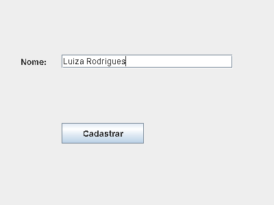
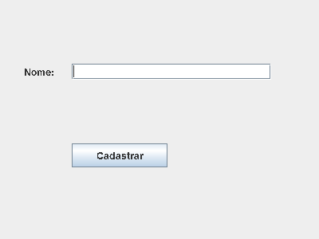
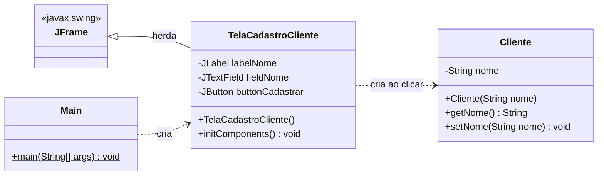
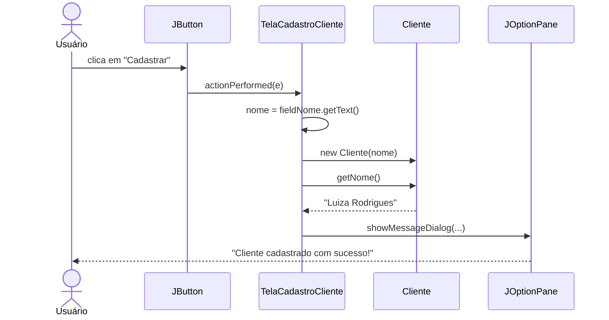

<div align="center">

# 🧑‍💼 AulaMarcela — Cadastro de Cliente com Java Swing

**Uma interface gráfica simples (1 rótulo + 1 campo de texto + 1 botão) construída com Programação Orientada a Objetos.**




</div>

---

## 📑 Navegação rápida

| Quero... | Ir para |
|---|---|
| Entender o objetivo da aula | [🎯 Objetivo](#-objetivo-da-aula) |
| Ver o progresso da aula | [✅ Checklist](#-checklist-da-aula) |
| Rodar o projeto agora | [▶️ Como executar](#️-como-executar) |
| Entender como as classes conversam | [🧩 Arquitetura](#-arquitetura) |
| Ler o código explicado | [🔍 Código explicado](#-código-explicado) |
| Treinar o que aprendi | [🏋️ Desafios](#️-desafios-para-praticar) |

---

## 🎯 Objetivo da aula

Desenvolver uma **interface gráfica** com:

- 🏷️ 1 rótulo (`JLabel`)
- ⌨️ 1 campo de texto (`JTextField`)
- 🔘 1 botão (`JButton`)

Usando **POO**, dividido em **3 classes**:

| # | Classe | Papel |
|---|---|---|
| 1 | `Cliente` | **Modelo**: guarda os dados do cliente |
| 2 | `TelaCadastroCliente` | **Visão**: a janela (herda de `JFrame`) |
| 3 | `Main` | **Inicialização**: ponto de entrada do sistema |

---

## ✅ Checklist da aula

<details open>
<summary><b>Parte 1 — Classe <code>Cliente.java</code></b> &nbsp; </summary>

- [x] Criar a classe, declarar os atributos e criar o construtor
- [x] Criar os métodos *getter* e *setter*
- [x] Testar a classe `Cliente` no `main`

</details>

<details open>
<summary><b>Parte 2 — Classe <code>TelaCadastroCliente.java</code></b> &nbsp; </summary>

- [x] Criar a classe herdando de `JFrame`, declarar os atributos e criar o construtor `initComponents()`
- [x] Configurar a janela
  - [x] Colocar o título
  - [x] Configurar a largura e a altura
- [x] Definir o layout absoluto
  - [x] Redimensionar o container onde os elementos ficarão
- [x] Configurar os rótulos
- [x] Configurar o `JTextField`
- [x] Configurar o `JButton`
- [x] Testar a interface
- [x] Configurar o clique do botão
- [x] Integrar as classes `Cliente` e `TelaCadastroCliente`

</details>

<details open>
<summary><b>Parte 3 — Classe <code>Main.java</code></b> &nbsp; </summary>

- [x] Implementar a classe `Main` que inicializa o sistema

</details>

---

## 🖼️ Veja funcionando

<table>
<tr>
<td align="center"><b>1️⃣ Ao abrir</b></td>
<td align="center"><b>2️⃣ Nome digitado</b></td>
</tr>
<tr>
<td></td>
<td></td>
</tr>
</table>

Ao clicar em **Cadastrar**, aparece uma caixa de diálogo:

```
┌──────────────────────────────────────────────┐
│ ℹ️  Cliente cadastrado com sucesso! Nome:     │
│     Luiza Rodrigues                          │
│                                   [  OK  ]   │
└──────────────────────────────────────────────┘
```

---

## ▶️ Como executar

> [!IMPORTANT]
> O `Main.java` usa a sintaxe **compacta** do Java moderno (método `main` solto, sem declarar `class`).
> Isso é recurso **padrão a partir do Java 25**. O projeto foi criado no IntelliJ com **JDK 26**.

<details open>
<summary><b>🅰️ IntelliJ IDEA (recomendado)</b></summary>

1. Clone o repositório e abra a pasta no IntelliJ (**File → Open**).
2. Confirme o SDK em **File → Project Structure → Project → SDK** (JDK 25 ou superior).
3. Abra `src/Main.java` e clique no ▶️ ao lado do `main`.

</details>

<details>
<summary><b>🅱️ Terminal — JDK 25 ou superior</b></summary>

```bash
git clone https://github.com/LuizaRodrigues2810/AulaMarcela.git
cd AulaMarcela

javac -d out src/*.java
java -cp out Main
```

</details>

<details>
<summary><b>🅲 Terminal — JDK 21 a 24 (modo preview)</b></summary>

```bash
javac --enable-preview --release 21 -d out src/*.java
java  --enable-preview -cp out Main
```

Troque o `21` pela versão do seu JDK.

</details>

<details>
<summary><b>🩺 Deu erro? Veja o que pode ser</b></summary>

| Mensagem | Causa provável | Solução |
|---|---|---|
| `unnamed classes are a preview feature` | JDK anterior ao 25 | Use a opção 🅲 ou atualize o JDK |
| `Could not find or load main class Main` | Compilou em outra pasta | Rode `java -cp out Main` na raiz do projeto |
| `HeadlessException` | Ambiente sem tela (servidor/SSH) | Rode em um computador com interface gráfica |

</details>

---

## 🧩 Arquitetura



### 🔄 O que acontece quando o usuário clica em "Cadastrar"



### 📁 Estrutura do projeto

```
AulaMarcela/
├── src/
│   ├── Cliente.java               # Modelo (dados)
│   ├── TelaCadastroCliente.java   # Janela Swing (visão + evento)
│   └── Main.java                  # Ponto de entrada
├── docs/                          # Imagens deste README
├── AulaMarcela.iml                # Módulo do IntelliJ
└── README.md
```

---

## 🔍 Código explicado

> Clique em cada bloco para expandir.

<details>
<summary><b>📦 <code>Cliente.java</code> — o modelo</b></summary>

```java
public class Cliente {

    private String nome;                 // atributo encapsulado (private)

    public Cliente(String nome){         // construtor: recebe o nome ao criar
        this.nome = nome;
    }

    public String getNome() {            // getter: lê o valor
        return nome;
    }

    public void setNome(String nome) {   // setter: altera o valor
        this.nome = nome;
    }
}
```

**Conceitos:**

| Conceito | Onde aparece |
|---|---|
| **Encapsulamento** | `nome` é `private`; só se acessa por `getNome()` / `setNome()` |
| **Construtor** | `Cliente(String nome)` obriga informar o nome ao criar o objeto |
| **`this`** | Diferencia o atributo `this.nome` do parâmetro `nome` |

</details>

<details>
<summary><b>🪟 <code>TelaCadastroCliente.java</code> — a janela</b></summary>

#### 1. Herança e atributos

```java
public class TelaCadastroCliente extends JFrame {   // É uma janela!

    private JLabel labelNome;
    private JTextField fieldNome;
    private JButton buttonCadastrar;

    public TelaCadastroCliente(){
        initComponents();    // monta tudo assim que a janela é criada
    }
```

#### 2. Configurando a janela

```java
this.setTitle("Cadastrar Cliente");
this.setSize(400, 300);        // largura x altura (px)
this.setResizable(false);      // tamanho fixo
this.setDefaultCloseOperation(WindowConstants.EXIT_ON_CLOSE);  // fechar = encerrar o programa
```

#### 3. Layout absoluto

```java
this.getContentPane().setLayout(null);   // sem gerenciador: você posiciona tudo
```

Com `setBounds(x, y, largura, altura)` cada componente fica numa posição exata:

```
(0,0) ─────────────────────────────▶ x
  │
  │      (30,80)  Nome:  [______________________]   ← y = 80
  │
  │
  │      (90,180) [ Cadastrar ]                      ← y = 180
  ▼ y
```

| Componente | `x` | `y` | Largura | Altura |
|---|---:|---:|---:|---:|
| `labelNome` | 30 | 80 | 70 | 20 |
| `fieldNome` | 90 | 80 | 250 | 20 |
| `buttonCadastrar` | 90 | 180 | 120 | 30 |

#### 4. O clique do botão

```java
buttonCadastrar.addActionListener(
    new ActionListener() {
        @Override
        public void actionPerformed(ActionEvent e) {
            String nome = fieldNome.getText();       // 1. lê o texto digitado
            Cliente cliente = new Cliente(nome);     // 2. cria o objeto
            JOptionPane.showMessageDialog(null,      // 3. mostra o resultado
                " Cliente cadastrado com sucesso!" +
                " Nome: " + cliente.getNome());
        }
    }
);
```

> ⚠️ O `Cliente` criado no clique **não é armazenado em lugar nenhum**: ele só serve para montar a mensagem e é descartado em seguida.

> 💡 O `ActionListener` é uma **classe anônima**: um "ouvinte" que o Swing chama sempre que o botão é clicado.
> É por isso que existem os arquivos `TelaCadastroCliente$1.class` e `$2.class` na pasta `out/`.

#### 5. Exibindo

```java
this.setVisible(true);   // sem isso a janela nunca aparece
```

</details>

<details>
<summary><b>🚀 <code>Main.java</code> — a inicialização</b></summary>

```java
public static void main(String[] args) {

    TelaCadastroCliente tela = new TelaCadastroCliente();

}
```

Criar a `TelaCadastroCliente` já chama `initComponents()` e termina com `setVisible(true)`, então a janela abre sozinha.

> 📝 A classe `TelaCadastroCliente` também tem um `void main()` com `SwingUtilities.invokeLater(...)`.
> Ele **não é usado** (o ponto de entrada é o `Main`), mas mostra a forma recomendada de abrir janelas Swing: dentro da *Event Dispatch Thread*.

</details>

---

## 📚 Glossário Swing

| Classe | Para que serve | Exemplo no projeto |
|---|---|---|
| `JFrame` | Janela principal | `TelaCadastroCliente extends JFrame` |
| `JLabel` | Texto fixo na tela | `new JLabel("Nome: ")` |
| `JTextField` | Entrada de texto de uma linha | `fieldNome.getText()` |
| `JButton` | Botão clicável | `new JButton("Cadastrar")` |
| `JOptionPane` | Caixas de diálogo prontas | `showMessageDialog(...)` |
| `ActionListener` | Reage a eventos (ex.: clique) | `addActionListener(...)` |
| `setBounds(x,y,w,h)` | Posição e tamanho (layout nulo) | `labelNome.setBounds(30,80,70,20)` |

---

## 🏋️ Desafios para praticar

<details>
<summary>🟢 <b>Nível 1 — Iniciante</b></summary>

- [ ] Mudar o título da janela e o texto do botão
- [ ] Trocar o tamanho da janela para `500 x 350`
- [ ] Reposicionar o botão para ficar centralizado

</details>

<details>
<summary>🟡 <b>Nível 2 — Intermediário</b></summary>

- [ ] Impedir o cadastro quando o campo estiver vazio (mostrar `JOptionPane.WARNING_MESSAGE`)
- [ ] Limpar o campo de texto depois de cadastrar (`fieldNome.setText("")`)
- [ ] Adicionar um segundo campo, **e-mail**, e o atributo `email` em `Cliente`

</details>

<details>
<summary>🔴 <b>Nível 3 — Avançado</b></summary>

- [ ] Trocar o layout nulo por `GridBagLayout` ou `BorderLayout`
- [ ] Abrir a janela com `SwingUtilities.invokeLater(...)`

</details>

---

## 🛠️ Tecnologias

- **Java** (sintaxe compacta de `main`, Java 25+)
- **Java Swing** (`javax.swing`) para a interface
- **IntelliJ IDEA** como IDE
- **Git / GitHub** para versionamento

---

## 👩‍💻 Autoria

Projeto desenvolvido por [**@LuizaRodrigues2810**](https://github.com/LuizaRodrigues2810) durante a aula de Interface Gráfica com Swing.

<div align="center">

⭐ Se este material te ajudou, deixe uma estrela no repositório!

</div>
